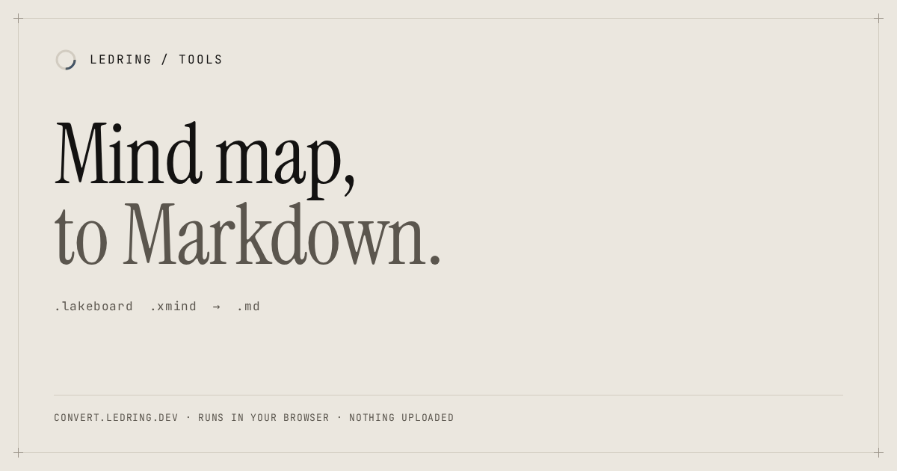

# lakeboard-converter

Universal mind maps your agents can actually read — convert **9 formats** (XMind, OPML, FreeMind/Freeplane, MindManager, iThoughts, SimpleMind, Lakeboard, Markdown, CSV) into clean Markdown via Web, CLI, or MCP.

[](https://www.npmjs.com/package/lakeboard-converter)
[](./LICENSE)

English | [简体中文](./README.zh-CN.md)

[](https://convert.ledring.dev)

**[Convert a map in your browser → convert.ledring.dev](https://convert.ledring.dev)** — runs locally, nothing is uploaded.

## What it does

Feed any supported mind map (`.xmind`, `.opml`, `.mm`, `.mmap`, `.itmz`, `.smmx`, `.lakeboard`, `.md`, `.csv`) and get structured Markdown with hierarchy, notes, links, and labels intact:

```text
launch-plan.xmind
└── Launch plan
    ├── Alpha  [note: "Ship the reader"]
    └── Docs   [link: https://example.com/docs, label: P1]
```

```bash
npx -y lakeboard-converter read ./launch-plan.xmind
```

```markdown
# Launch plan
- Alpha
  > Ship the reader
- [Docs](https://example.com/docs) `P1`
```

## MCP Quickstart

Give Claude Code, Cursor, Claude Desktop, or any MCP client direct read access to mind maps with zero API keys or setup.

**Claude Code:**

```bash
claude mcp add lakeboard-converter -- npx -y lakeboard-converter mcp
```

**Cursor** (`.cursor/mcp.json` or `~/.cursor/mcp.json`) and **standard `mcpServers` JSON** (Claude Desktop, Cline, Windsurf):

```json
{
  "mcpServers": {
    "lakeboard-converter": {
      "command": "npx",
      "args": ["-y", "lakeboard-converter", "mcp"]
    }
  }
}
```

Exposed MCP tools:
- `convert`, `convert_many` (1–50 files), and `inspect` — **read-only**. `inspect` reports file size, topic counts, and detected `source` format without dumping content.
- `from_markdown` — builds a `.xmind` file from Markdown (capped at 2 MB). Writes only to an explicit path in an existing folder (`overwrite: true` to replace), or returns base64 when no path is passed.

See [llms-install.md](./llms-install.md) for full tool arguments and troubleshooting.

## Supported Formats (9)

One command reads all 9 formats. `mindmap-converter` is an alias for `lakeboard-converter` (the npm package name stays `lakeboard-converter`).

| Format | Extensions | Read → Markdown | Write |
| --- | --- | --- | --- |
| XMind (Zen & XMind 8) | `.xmind` | Yes | XMind |
| OPML (incl. MindNode OPML export) | `.opml` | Yes | — |
| FreeMind & Freeplane | `.mm` | Yes | — |
| MindManager | `.mmap` | Yes | — |
| iThoughts | `.itmz` | Yes | — |
| SimpleMind | `.smmx` | Yes | — |
| Lakeboard (Yuque) | `.lakeboard` | Yes | XMind |
| Markdown outline (headings, lists, markmap) | `.md`, `.markdown` | Yes | XMind |
| CSV outline (one topic per row; column = depth) | `.csv` | Yes | — |

Floating topics are kept. Relationships, summary topics, encrypted topic bodies, links that are not `http`/`https`/`mailto`, and notes with no plain text are reported in `losses` and on a `> Note:` line (see [docs/conversion.md](./docs/conversion.md)). Zip inputs are refused above 32 MiB compressed, 32 MiB inflated, or 1024 members. XMind Zen links are kept as stored. Styles, layout, and icons are omitted without a warning. MindManager notes are plain text. A CSV row with several topics is rejected. Native MindNode packages are not read; export OPML.

## CLI Usage

Requires Node.js 20.12 or newer.

```bash
npm install -g lakeboard-converter
```

```bash
lakeboard-converter read ./map.opml
lakeboard-converter convert ./map.xmind --format md --out-dir ./out
lakeboard-converter build plan.md -o plan.xmind
```

Run `lakeboard-converter` with no subcommand to open the interactive prompts.

- `convert` does not replace an existing file unless you pass `--overwrite`. `--format` is `md`, `xmind`, or `both` (default `both`). `--markdown-style` is `generic` (default) or `xmind`.
- `read` prints `md` (default), `json`, or `outline`. The default node cap is 2000 (`--max-nodes`, from 1 to 50000). The root is depth 0. Since 0.4.0, JSON for more than one sheet is `{ sheets: [{ index, title, root }] }`. `--sheet` is a 1-based index or a sheet title.
- When a file omits structure the parser can see, `read`, `inspect`, and `convert` print `> Note:`. `--json` puts the same counts in `losses`.

## Contributing & Security

- Contributions are welcome — see [CONTRIBUTING.md](./CONTRIBUTING.md).
- Security model and vulnerability reporting — see [SECURITY.md](./SECURITY.md).

## License

[MIT](./LICENSE)
