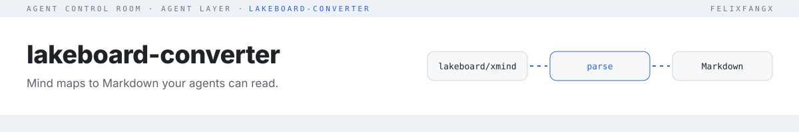

<picture>
  <source media="(prefers-color-scheme: dark)" srcset="./docs/assets/header-dark.svg">
  
</picture>

**Convert Yuque Lakeboard (`.lakeboard`) and XMind (`.xmind`) mind maps into Markdown or a fresh `.xmind`.** Comes as a CLI, a guided TUI, an MCP server and a drag-and-drop web UI ([convert.ledring.dev](https://convert.ledring.dev)). English | [简体中文](./README.zh-CN.md)

## Quickstart

```bash
git clone https://github.com/FelixFangX/lakeboard-converter.git
cd lakeboard-converter && npm ci
npm run convert -- ./test-fixtures/test.lakeboard --format md --out-dir ./out
```

Requires Node 20.12+.

## Usage

| Mode | Command |
|---|---|
| Guided TUI | `npm run dev` |
| CLI | `npm run convert -- <file> --format md\|xmind\|both [--markdown-style generic\|xmind] [--out-dir DIR] [--output FILE] [--overwrite]` |
| Web UI | `npm run dev:web` (production build: `npm run build:web`) |
| Library (from source) | `import { convertBuffer, convertFile } from './src/index.js'` |

Existing output files are never overwritten unless you pass `--overwrite`.

## Web UI

Live demo: https://convert.ledring.dev

The web UI runs entirely in your browser: files never leave your machine. It is self-hosted with no third-party requests, including fonts. Run `npm run dev:web` locally, or try the bundled Lakeboard and XMind samples.

### Deploy (Cloudflare Workers)

With `CLOUDFLARE_API_TOKEN` and `CLOUDFLARE_ACCOUNT_ID` set in your environment:

```bash
npm ci && npm run deploy:web
```

`wrangler.jsonc` serves `dist-web/` as static assets with single-page application fallback.

To deploy a preview build to `lakeboard-convert-preview.<subdomain>.workers.dev` instead (it has no custom domain), run `npm run build:web && npx wrangler@3 deploy --env preview`.

## For agents (MCP and `--json`)

Agents get one read-only tool, `convert(path, format)`, where `format` is `md`, `json` (topic tree) or `outline` (compact indented text). Requires Node 20.12+.

Start the MCP server:

```bash
npx -y lakeboard-converter mcp
```

Claude Desktop (`claude_desktop_config.json`):

```json
{
  "mcpServers": {
    "lakeboard-converter": {
      "command": "npx",
      "args": ["-y", "lakeboard-converter", "mcp"]
    }
  }
}
```

Cursor (`.cursor/mcp.json` or `~/.cursor/mcp.json`):

```json
{
  "mcpServers": {
    "lakeboard-converter": {
      "command": "npx",
      "args": ["-y", "lakeboard-converter", "mcp"]
    }
  }
}
```

Codex CLI (`~/.codex/config.toml`):

```toml
[mcp_servers.lakeboard-converter]
command = "npx"
args = ["-y", "lakeboard-converter", "mcp"]
```

Read a file from the CLI, or install the CLI globally:

```bash
npx -y lakeboard-converter read ./map.xmind --format md
npm i -g lakeboard-converter
```

### From source

```bash
npm run build
node /abs/path/lakeboard-converter/dist/cli.js mcp
node dist/cli.js read ./test-fixtures/test.lakeboard --format json --json
node dist/cli.js convert ./test-fixtures/test.xmind -f md --out-dir out --json
```

Every JSON result has `schemaVersion: 1`, `source`, `format`, `nodeCount`, `maxDepth` and `content`. Errors with `--json` print `{"error": "..."}` and exit 1. See [AGENTS.md](./AGENTS.md) for contributors.

## How it works

```text
.lakeboard ─┐                          ┌─ renderGenericMarkdown → # root + nested list
            ├─ parse → MindMapDocument ─┼─ renderXmindMarkdown  → single-root list for XMind import
.xmind ─────┘     (TopicNode tree)      └─ renderXmind          → minimal .xmind package
```

The **seam** is `convertBuffer` / `convertFile` in `src/index.ts`. Every input format parses into one `MindMapDocument`, so a new format needs one parser and no renderer changes. The CLI, TUI and web UI are thin adapters over that seam; agents use `readMindMap` in `src/agent.ts`, which never writes files.

Keeps text, hierarchy, order, notes and links. XMind labels are kept in the JSON output (`--format json`, MCP `format: "json"`) but not yet in Markdown. Only the first sheet of an `.xmind` is read. Drops styling, colour and layout. XMind 8 (legacy XML) isn't supported.

## Testing

```bash
npm test            # vitest specs at the convert, readMindMap and MCP seams, using test-fixtures/
npm run typecheck
```

## License

[MIT](./LICENSE)
